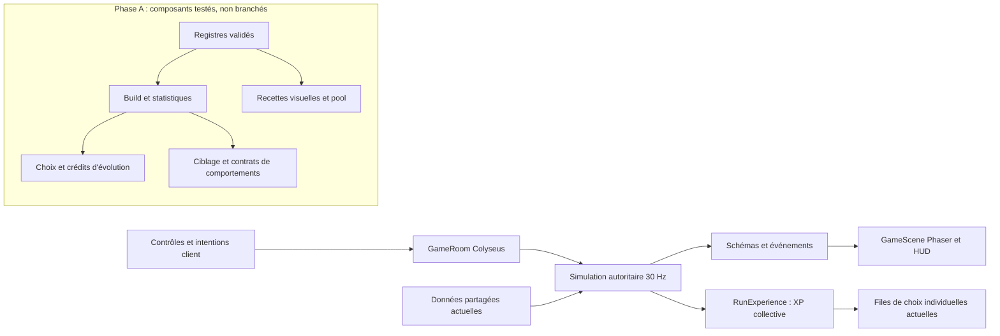

# Audit technique et préparation roguelite — phase A

État observé le 17 octobre 2026, dans le dossier local `Risk of dof`, HEAD `c66349f6`.
Le dossier comporte déjà de nombreuses modifications et des fichiers non suivis, dont la refonte XP et neuf kits de classe. Ils font partie de la version auditée : HEAD seul ne représente pas ce jeu local. Aucun alignement, téléchargement ou déploiement du dépôt distant n'a été effectué.

`ROGUELITE_GAME_DESIGN.md` est absent. Aucun document de design n'a été créé ou modifié. Cette livraison couvre la phase A ; les étapes B et C attendent le document **et sa validation**.

## 1. Périmètre et architecture réelle

Le jeu navigateur est un monorepo npm à trois workspaces TypeScript. `My project/` et `Pokevivor/` sont des projets Unity distincts, avec leurs propres Assets, Packages et Library ; ils ne participent ni aux workspaces ni au build web. Leurs caches, assets et sources n'ont pas été refactorisés.

| Domaine | Implémentation locale | Dépendances / suite de la refonte |
|---|---|---|
| Entrée et outils | `package.json`, workspaces `shared`, `server`, `client`, `tsconfig.base.json` | TypeScript strict ; `tsx` exécute le serveur, les outils et les tests. Vite construit le client. |
| Phaser | `client/src/main.ts`, `game/GameScene.ts`, `MapView`, `EntityView` | `main` pilote les menus, le compte et la salle. La scène réconcilie le schéma serveur et la prédiction du déplacement ; elle n'attribue aucun dégât. |
| Réseau | `server/src/rooms/GameRoom.ts`, `state.ts`, `shared/src/types.ts` | Colyseus, simulation 30 Hz, patches 50 ms, protocole actuel 8, quatre joueurs maximum. Les casts sont des événements, les projectiles physiques restent serveur. |
| Autorité | `server/src/game/Simulation.ts` | Joueurs, tirs, collisions, statistiques, niveaux, récompenses et transitions de zones sont centralisés. Les handlers de salle transmettent des intentions validées. |
| Classes | `shared/src/data/classes.ts`, `class-rework.ts`, `mechanics.ts` | 12 classes, quatre sorts par défaut chacune. Neuf kits ont une refonte locale en cours. `ClassMechanics` délègue ces kits à `ClassRework`, mais conserve aussi de nombreuses branches historiques. |
| Sorts et talents | `data/spells.ts`, `talents.ts`, `spell-upgrades.ts` | 130 définitions au total, dont 87 identifiants uniques accessibles aux classes ; le reste comprend attaques de monstres, compagnons et invocations. Ne pas convertir tout `SPELLS` en pool d'acquisition. `sanitizeLoadout` impose encore la classe et les slots. |
| Identité d'attaque | `Simulation.playerCast`, `sourceDamageMultiplier`, hooks de classe / Dofus | Le slot 0 est une attaque de base, le slot 1 a des charges ; vol de vie, Échos, élan et nombreux procs en dépendent. Un simple changement de tableau casserait ces règles. |
| Auto-cast | `Simulation.updateAutoAttacks`, `Controls.ts`, `GameScene` | L'auto-attaque actuelle vise le plus proche pour le slot 0 seulement. Les autres sorts restent manuels. Dash et action de classe sont distincts. |
| Passifs actuels | `ClassMechanics`, `ClassRework`, `Blessings`, `data/blessings.ts` | Mécaniques innées parfois actives avec F ; 30 bénédictions d'élite à trois rangs, hooks de cast, hit, kill, soin, dégâts et mouvement. Pas de quatre slots de passifs temporaires actuellement. |
| XP | `RunExperience.ts`, `data/run-progression.ts`, `XpView.ts`, HUD | Orbes serveur persistantes, fusion avec conservation de valeur, plafond de 320 objets, attribution unique, niveau et XP communs à l'équipe. Aspiration globale de boss et niveaux différés pendant l'animation. À conserver. |
| Choix temporaires | `Simulation.boonQueues`, `offerLevel`, `chooseBoon`, `MechanicHud` | Trois choix statistiques / recharge / zone / double projectile, avec validations de compatibilité. File commune au code des bénédictions mais personnelle à chaque joueur. Solo suspendu, multi : sélection automatique après 25 s. Révision anti-rejeu déjà présente. |
| Permanents | `spell-upgrades.ts`, `account.ts`, `Talents.ts`, authentification serveur | Cinq achats, stockés sous niveaux internes 1 à 6 ; maximum +30 % dégâts, −15 % recharge. Migration historique versionnée. Décider leur avenir avant toute suppression. |
| Statistiques | `Simulation.applyStats`, `items.ts`, `affinities.ts`, `combat-balance.ts` | Somme des bonus de run et affinités, équipement figé, armure de classe, bénédictions, buffs, vol de vie inné et Dofus puis plafonds. PV et vitesse dérivés ensuite. Les stats plafonnées sont exposées au client via `combatStats`. |
| Résolution d'un sort | `upgradedRunSpell`, `Blessings.prepareSpell`, hooks `beforeCast` / `afterCast` | Paliers permanents puis amélioration temporaire, transformations de classe, cooldown plafonné, multiplicateurs et critiques. Les sorts posés / projectiles conservent leur snapshot. Des chemins spéciaux de classe gèrent eux-mêmes le cast. |
| Équipements et drops | `equipment.ts`, `equipment-scaling.ts`, sets, forge, pets, `dofus.ts`, pages équipement | Catalogue, qualité, panoplies, Dofus et familiers distincts des bonus de run. Drops crédités par identifiant, récompenses persistantes. À conserver ; ne pas appliquer les statistiques des Dofus une deuxième fois. |
| Économie | `runKamasReward`, `equipmentReward`, `account`, talents / compagnons | Kamas de fin de run utilisés pour déblocages, paliers permanents et retirage du compagnon. Fragments de forge et Ogrines ont leurs propres circuits. Aucun achat ne doit utiliser l'XP collective. |
| Physique | `Simulation.cast`, `updateProjectiles`, `explode`, `applyHit`, `map.ts` | Collisions balayées, rayon en coordonnées monde, cônes, zones circulaires, tirs perçants avec ensemble de cibles touchées. Glyphes / pièges ont durée, ticks et propriétaire ; invocations gérées séparément. Les rectangles/orbites nécessiteront des adaptateurs physiques. |
| Effets et assets | `Effects.ts`, `SpellPreview.ts`, `assets/store.ts`, manifest, outils d'extraction | Assets Retro et placeholders ; aperçu géométrique partagé partiellement avec le serveur. Couplages encore présents aux IDs et aux icônes. Budgets cosmétiques, texte et XP déjà poolés ; les sprites des projectiles/FX restent largement créés puis détruits. |
| Durées et nettoyage | Timers, changements de zone, `resetPlayer`, `finishRun`, shutdown de scène | Les ticks, invocations, marques, procs différés et listeners doivent garder propriétaire, run et génération. Une évolution ne doit pas dupliquer une aura ou réinitialiser gratuitement sa recharge. |
| Reconnexion | `GameRoom.onDrop` / `onReconnect`, `main.ts` | Conservation de l'objet joueur pendant 120 s, gel si tous déconnectés, retour au même état serveur. Le build ne doit pas être réimporté du client. Un nouveau joueur reçoit déjà les choix de rattrapage du niveau commun. |
| Sauvegardes | `progression.ts`, `account.ts`, `cloud.ts`, `server/cloud.ts`, migrations SQL | Compte version 3, catalogue équipement version 2, progression des sorts version 2. localStorage invité/utilisateur, sauvegarde Supabase à révision optimiste. Le serveur relit la progression authentifiée. Le migrateur reconstruit les champs connus : une archive de compensation doit être explicitement ajoutée au schéma futur pour survivre à cette étape. |
| Interfaces | `Hud`, `MechanicHud`, `Details`, `Talents`, `Rest`, sélection de classe | XP commune et trois cartes déjà visibles. Barre de quatre sorts existante ; pas de quatre passifs nivelés ni indicateur d'évolution. Tooltips et aperçu résolvent encore les anciens niveaux. La halte gère routes/prêt, sans magasin de coffres. |
| Publication | `.github/workflows/deploy.yml`, Dockerfile, render.yaml | CI : types, tests, build puis client Pages. Serveur hébergé séparément ; toute modification de protocole en phase C exigera une livraison coordonnée. Aucune publication dans cette phase. |

Recherche transversale : `kamas`, `chest`, `fortune`, anciennes copies et paliers, noms/IDs de sorts, casts, inventaire, événements et sérialisation. Les variables locales `chest` des balises désignent des défis gratuits, pas des coffres ordinaires. `coffre_anime` est une invocation Enutrof encore utile ; `roue_de_la_fortune` est un sort Écaflip. Ces noms ne justifient pas une suppression.

## 2. Composants ajoutés et frontière d'activation

Nouvelle entrée explicite `@rod/shared/roguelite`, distincte de l'entrée actuellement utilisée en jeu. Aucun import de cette entrée dans `Simulation`, `GameRoom`, le schéma Colyseus, Phaser ou les interfaces. Les nouvelles autorités ne sont instanciées que dans les tests. C'est une préparation au remplacement, pas une seconde progression active.

| Fichier | Fonction prête et testée | Limite actuelle |
|---|---|---|
| `shared/src/roguelite/types.ts` | Contrats de sorts, passifs, classes, évolutions, géométries, visuels, progression et limites. Canal de dégâts explicite indépendant du slot. | Aucun catalogue de gameplay nouveau. |
| `catalog.ts` | Index immuables par IDs, références croisées, rangs, paramètres numériques, géométrie, bornes de cooldown/projectiles, associations d'évolution. | Les IDs d'assets, créatures et hooks devront aussi être résolus dans leurs registres d'exécution à l'intégration. |
| `build.ts` | Signature facultative, inné hors slots, acquisition, progression, validation, remplacement d'évolution au même emplacement, rang complet de chaque passif. | Le build temporaire ne contient ni équipement permanent, ni XP, ni niveau collectif. |
| `rewards.ts` | Trois offres distinctes, sans capacités pleines/maximisées, diversité des catégories, poids et tags de synergie, RNG injecté. | Nécessite trois alternatives distinctes définies par le designer ; aucun effet alternatif inventé. |
| `targeting.ts` | Proche, loin, prioritaire, densité, mouvement, autour de soi, cible d'invocation ; exclusion de cibles non valides et égalités stables. | Densité en O(n²) ; à profiler avec les sorts retenus avant optimisation par grille. Pas de pathfinding / visibilité ajouté implicitement. |
| `stats.ts` | Ordre explicite des couches et bindings par sort (addition, bonus multiplicatif, division pour recharge), caps appliqués ensuite, doublons refusés. | Adaptateurs des passifs complexes, Dofus et formule actuelle de puissance à écrire suivant le design ; le multiplicateur simple de test ne remplace pas silencieusement la formule existante. |
| `visuals.ts` | Composition de couches par phase/délai et pool d'objets borné, sans lien avec les collisions. | Adaptateur Phaser non branché. Son reset devra annuler tweens, timers, listeners et traînées avant réemploi. Le pool borne les cosmétiques, jamais les gains ou dégâts. |
| `server/src/game/roguelite/RunBuildController.ts` | Autorité par joueur/run, files de niveaux, offres révisionnées, temporisation multi, crédits de boss/élite dédupliqués, éligibilité tardive et consommation unique. | Ne reçoit pas encore les niveaux/décès de la vraie simulation et n'ajoute aucun message réseau. La persistance après redémarrage serveur n'est pas implémentée ; reconnexion = conservation de l'instance. |
| `server/src/game/roguelite/AbilityRuntime.ts` | Registre d'adaptateurs des 12 familles et hooks custom ; auto-cast, ciblage et cooldown personnel par slot conservé lors d'une évolution. | Contrats d'exécution : aucun nouveau moteur de collision/invocation. Un comportement sans adaptateur échoue explicitement. |

Les définitions synthétiques de `tests/fixtures/roguelite.ts` servent exclusivement aux tests. Elles ne constituent pas une sélection de sorts, de passifs ou des valeurs d'équilibrage proposées à Claude.

### Paramètres de préparation

Valeurs centralisées dans `ROGUELITE_PREPARATION_CONFIG` : quatre slots de sorts, quatre passifs, plafond de huit niveaux de sort et cinq de passif, trois cartes, délai multi 25 000 ms. Poids de catégories à 1 et bonus de synergie à 0 : valeurs neutres en attente du design. Récompense d'évolution tardive conservée par défaut (`bank`), option `discard` testée. Budgets techniques provisoires : 32 projectiles par cast, 16 couches par recette et 256 effets visuels actifs. **Ces valeurs ne modifient pas le jeu actuel.** Chaque sort doit fournir ses bornes propres de recharge et de projectiles ; les autres dimensions peuvent également être bornées par définition.

### Ordre futur des statistiques

1. Addition des statistiques personnage : base → inné → équipement/Dofus déjà résolus une fois → rangs des passifs temporaires → buffs ; plafonds personnage ensuite.
2. Choix de la définition effective du sort : normale ou définition de remplacement évoluée. Une évolution ne cumule pas ses dégâts de base avec ceux de l'ancienne capacité.
3. Application des transitions de niveaux temporaires propres à cette définition. Elles remplacent explicitement certains paramètres, sans multiplier indistinctement toutes les familles.
4. Application des seules statistiques personnage déclarées dans les bindings du sort, dans leur ordre déclaré ; bornes propres au sort en dernier.
5. Snapshot serveur au cast pour les collisions, critiques et ticks ; rendu et aperçu lisent les mêmes paramètres effectifs. Les hooks complexes interviennent à des étapes explicites et ne réappliquent pas l'équipement.

Le maintien des paliers permanents de sort reste à arbitrer. Leur formule actuelle continue de fonctionner dans le jeu actuel ; aucune nouvelle formule ne les absorbe ou ne les supprime dans cette phase.

## 3. Plan d'intégration vérifiable

### Phase B — après réception et validation du design

1. Lire intégralement le document validé, référencer sa version et confronter chaque mécanique aux points de `ROGUELITE_TECHNICAL_FEEDBACK.md`. Ne pas traiter la simple présence du fichier comme une validation.
2. Renseigner les registres réels : sorts retenus, signatures, innés, passifs, niveaux, caps, associations et recettes visuelles. Vérifier les clés d'assets et signaler les éléments absents. Tester les définitions sans modifier les comptes.
3. Adapter les primitives existantes de `Simulation.cast` / hit / ticks / summons aux comportements nécessaires. Conserver propriétaire, snapshots, cibles déjà touchées et protection des procs. Remplacer les dépendances au slot par des métadonnées explicites lorsque le design le prévoit. Garder le dash.
4. Au démarrage de run, créer un contrôleur individuel ; le callback de **RunExperience existant** alimente les files de ces contrôleurs. Basculer l'ancien tirage vers ce contrôleur en une seule opération cohérente. Ne pas alimenter les deux systèmes.
5. Adapter HUD, quatre slots de passifs, niveaux de sorts, description de signature/inné, cartes et évolution. Garder l'XP d'équipe dans `GameState` ; séparer les snapshots individuels.

### Phase C — avant activation complète

1. Étendre `PlayerState`/`PlayerView` et les intentions réseau avec révision de choix, révision de build et identité de run. Déduire le joueur de la session. Le client n'envoie jamais de build, dégâts, cooldown ni XP autoritaire.
2. Mort de boss/élite : garder le crédit XP/aspiration actuel et attribuer séparément un crédit personnel d'évolution par événement admissible. Après évolution, invalider les cartes périmées et retirer proprement les runtimes persistants remplacés selon le design. Les tirs déjà partis doivent suivre la règle de snapshot décidée.
3. Reconnexion : conserver contrôleur, cooldowns, offres et crédits pendant la fenêtre actuelle de 120 s. Départ définitif : libérer les runtimes du joueur ; nouvelle arrivée : rattrapage des niveaux d'équipe sans transfert du build d'un autre joueur.
4. Appliquer une migration de compte versionnée, idempotente et réversible depuis l'archive avant toute suppression des anciens achats. Ajouter les champs nécessaires au migrateur client et à la lecture serveur/Supabase. Tester les conflits de sauvegarde et une deuxième hydratation.
5. Retirer les anciens tirages, niveaux de run incompatibles, slots imposés, calculs et messages devenus inutiles seulement une fois leur remplacement validé. Préserver équipement, drops, classement, historique et devises conservées.
6. Rejouer les tests unitaires, simulations réelles et réseau. Ajouter les cas quatre builds évolués, serveur/client retardés, joueur KO, reconnexion et changement de zone. Mesurer réellement charge serveur et rendu ; budgets et cap d'effets s'ajustent avec ces mesures.

## 4. Risques prioritaires de régression

- **Critique :** slot 0/1 utilisé comme règle de gameplay dans classe, bénédictions, Dofus, Échos, critiques, vol de vie et charges. Le canal de dégâts explicite prépare la sortie de cette dépendance ; son intégration demande des tests de chaque hook conservé.
- **Critique :** migration aveugle des achats et déblocages. Le prix actuel ne prouve pas le prix historiquement payé. Ne pas supprimer des champs ni créditer une compensation supposée sans politique validée.
- **Élevé :** application répétée de stats à chaque tick ou évolution, transformation d'une zone graphique en hitbox, compte double des critiques et des procs de plusieurs projectiles.
- **Élevé :** ancien choix encore affiché après acquisition/évolution ; crédits de boss rejoués ; arrivée tardive consommant les récompenses d'un autre joueur. Les fondations vérifient révisions, builds et crédits séparés.
- **Élevé :** effets actifs orphelins après évolution, mort, départ, changement de carte ou fin de run. L'adaptateur devra identifier chaque runtime par joueur, capacité et génération.
- **Élevé :** divergence du HUD/aperçu avec le serveur. Exposer une vue effective versionnée au lieu de refaire une variante de la formule dans chaque UI.
- **Moyen :** allocations de sprites et ciblage dense répété à chaque frame. Le pool est préparé, pas encore adopté par `Effects`. Le ciblage doit tourner au moment où un sort peut partir, pas pour chaque particule.

## 5. Vérification et limites

État initial : 185 tests réussis. La suite supplémentaire `tests/roguelite-foundation.test.ts` vérifie les registres, limites, acquisition, RNG, trois alternatives, progression, couches de stats, évolutions, révisions, crédits tardifs, quatre builds indépendants, auto-cast, composition et pooling. Elle passe également dans le typecheck des outils.

Les tests d'autorité préparée sont **en mémoire**, sans nouvelle salle Colyseus. Le scénario de charge logique effectue 800 choix et 16 évolutions sur quatre contrôleurs ; son temps est un diagnostic, pas un benchmark réseau ou graphique. Les tests réseau existants continuent de vérifier le jeu actuel, notamment l'XP commune et la reconnexion.

Validation de livraison : `npm.cmd test` **205/205 réussis** (185 existants + 20 nouveaux), `npm.cmd run typecheck` et `npm.cmd run build` réussis. Vérification des différences Git sans erreur d'espacement ; les avertissements de conversion LF/CRLF proviennent de la configuration Git Windows. Les tests des nouvelles fondations sont inclus dans le typecheck via `tsconfig.tools.json`. Aucun déploiement, push ou changement de sauvegarde/cloud effectué.

Ne sont pas validés dans cette phase : sorts du futur document, adaptateurs physiques des nouvelles familles, rendu des nouvelles évolutions, nouveau schéma Colyseus de builds, quatre navigateurs réels avec ce système, migrations cloud réelles et équilibrage des futurs builds. Aucun nouveau spellbook ou compte n'a été injecté dans le jeu pour contourner l'absence de design.
