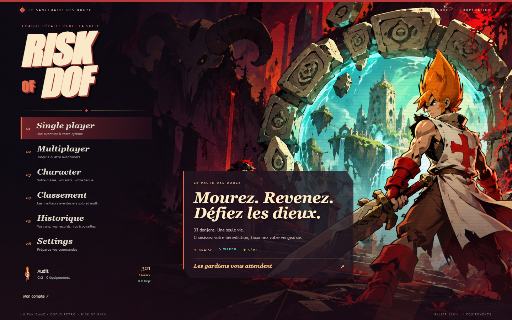

# Pacte des Douze : une refonte visible et un pouvoir dès le départ

La première passe Sanctuaire changeait surtout les couleurs et les cadres. Cette version ajoute une illustration d'accueil composée autour du Iop et d'un Zaap, des formes coupées, une typographie inclinée, des contrastes rouge/ivoire/obsidienne et des en-têtes gravés sur les pages. Les menus, inventaire, talents, historique, atlas, boutique et HUD utilisent ce langage. Settings permet toujours de revenir au parchemin.



[Préparation et pouvoirs](previews/pacte-preparation.png) · [Inventaire](previews/pacte-equipement.png) · [Marchand](previews/pacte-marchand.png) · [HUD](previews/pacte-combat.png)

L'illustration `client/public/assets/menu/sanctuary-infernal.jpg` a été générée avec imagegen à partir d'une frame originale du Iop (`cast1_5_*` de son atlas). La consigne préserve sa chevelure orange, sa tunique blanche à croix rouge et le Zaap, avec des ombres franches et une composition laissant l'espace au menu. C'est une illustration promotionnelle générée, pas un asset officiel. Le JPEG pèse 390 ko. Les sprites, équipements et animations en combat restent les originaux Retro. Les cartes n'ont pas été redessinées par cette passe ; le HUD et une légère vignette les accompagnent.

## Un premier choix avant les premiers ennemis

Dans Single player ou Multiplayer, choisissez l'une des trois bénédictions. Chaque joueur garde son choix personnel ; il est aussi modifiable dans le salon avant le départ. Il reste figé pendant la run et se retrouve dans les détails de l'historique. Les anciennes sauvegardes sans ce champ restent valides.

| Bénédiction | Effet réel |
|---|---|
| Foulée ardente | Maj laisse une explosion au point de départ : délai 0,45 s, rayon 2,4, dégâts égaux à 45 % de la moyenne de l'attaque de base avec le bonus de dégâts. |
| Orage en chaîne | La quatrième attaque de base qui touche déclenche un éclair vers trois autres ennemis maximum, à quatre cases par saut, pour 35 % de la moyenne de l'attaque de base par cible. |
| Écorce vengeresse | Après une perte de PV non fatale : bouclier 6 % des PV max, trois secondes, et riposte à 2,6 cases pour 45 % de la moyenne de l'attaque de base. Recharge six secondes. |

L'Orage compte un lancement qui touche une seule fois, même en zone. Échos, ricochets et dégâts de bénédiction ne le rechargent pas. Les effets excluent les alliés. La braise différée est annulée en cas de mort, départ ou changement de zone. L'Écorce ne réduit pas le coup déclencheur et ne sauve pas d'un coup fatal. Le HUD montre le choix, le compteur d'Orage ou la recharge de l'Écorce ; Tab donne les règles complètes. Les nouveaux sceaux et éclairs sont des effets vectoriels légers, pas des animations Retro annoncées comme originales.

## Vérifications

75 tests, vérification TypeScript client/serveur/shared/outils et build de production. Le test réseau vérifie les choix individuels de deux joueurs. Le parcours navigateur réel vérifie compte, profil, trois choix, démarrage, HUD, rechargement de la même run, marchand, historique et sauvegarde sur un second appareil. Les comptes temporaires sont supprimés.

192 simulations : 12 classes × deux graines × deux tenues × quatre cas. Normal, plafond après la zone 8 ou 900 secondes. Le bot utilise les actions et collisions du jeu ; il n'utilise son dash que sous pression et ne représente pas toutes les façons humaines d'exploiter une bénédiction.

| Bénédiction | Sans stuff : zone moyenne / 24 | Palier 80 rare : zone moyenne / 24 | Runs équipées encore vivantes au plafond |
|---|---:|---:|---:|
| Aucune, référence | 1,96 | ≥ 4,96 | 3 |
| Foulée ardente | 1,96 | ≥ 5,08 | 4 |
| Orage en chaîne | 2,04 | ≥ 5,13 | 2 |
| Écorce vengeresse | 1,96 | ≥ 5,46 | 2 |

Toutes les runs sans stuff meurent entre les zones 1 et 3. Les bornes des runs équipées comprennent des runs interrompues au plafond, pas des décès. Ces échantillons ne prouvent pas un classement de puissance définitif entre les choix.

```powershell
npm.cmd run simulate:runs -- --seeds=2 --tiers=-1,2 --modes=1 --blessing=storm --cap=8 --seconds=900
```

Les anciens serments au marchand, affinités et patterns de boss restent présents. Ces bénédictions ajoutent un changement immédiat aux actions du joueur, sans remplacer les mécaniques de classe. Le protocole passe à 4 ; les deux côtés doivent être déployés ensemble.
