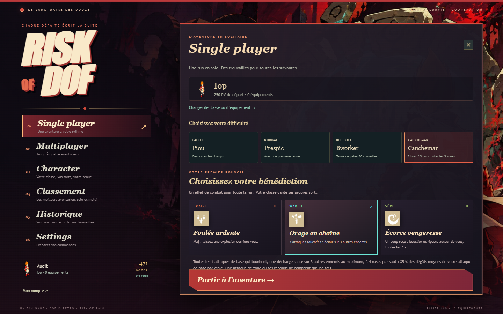

# Équipement 170–200 et Cauchemar

Le catalogue passe de 82 à **131 objets** : **49 équipements** supplémentaires, extraits du cache et des fichiers SWF de l'installation locale Dofus Retro. Les neuf paliers de progression sont propres à Risk of Dof ; ils ne prétendent pas reproduire les niveaux d'équipement exacts du MMO.

| Palier | Première zone | Équipements ajoutés | Exemples |
|---|---:|---:|---|
| 170 | 13 | 12 | Minotot, Rod Gerse, Dagues Eudin, Miniminotot |
| 180 | 18 | 12 | Souveraine, Ripage, Sous-bois, Champmanique, Tifoux |
| 190 | 25 | 11 | Ougah, Bracelet Ventré, Mycosine, Chaussons Pignons, Erforée |
| 200 | 31 | 14 | Ventouse, Voile d'encre, Harnage, Chapignon, Az'tech, Kimbo |

Les six nouvelles panoplies sont Minotot, Souveraine, Ougah, Bworker Berserker, Bworker Gladiateur et Ventouse. Les bonus des grandes panoplies continuent jusqu'à sept pièces lorsqu'elles en comportent sept. Certaines panoplies se complètent sur plusieurs paliers.

Les cinq paliers précédents gardent leurs identifiants et leurs caractéristiques. Les sauvegardes conservent piles, qualités, forge, équipement porté et monnaie. Les bornes du meilleur palier suivent désormais la taille du catalogue ; un objet 200 et son tier légendaire survivent à la relecture. Le budget de puissance ne baisse plus artificiellement lorsqu'on ajoute un palier après 160.

Les règles de drop sont inchangées : 3 % d'équipement sur chaque ennemi, source zone courante et deux précédentes, raretés des sources précédentes ×3. Les dix Dofus restent accessibles sur tous les boss à 3 % par boss. Le tableau complet de **524 jets fixes** est dans [OBJETS_DROPS.md](OBJETS_DROPS.md) et [objets-drops.csv](objets-drops.csv).

## Cauchemar

Le quatrième mode est choisi avant le départ solo ou par l'hôte dans le salon multi. Il ajoute deux gardiens à chaque Zaap, trois toutes les trois zones. Le premier est le gardien prévu, éventuellement surprise selon la règle existante. Ses compagnons proviennent des gardiens précédents ; au tout début de l'expédition, les premiers donjons complètent le groupe sans doublon.

- PV des monstres ×4,2, dégâts ×2,8, budget des hordes ×1,95, kamas de fin de run ×3,4, comparés au coefficient neutre du moteur.
- Chaque gardien reçoit 72 % du budget individuel en duo, 56 % en trio. Le total reste supérieur au gardien unique. Les PV et dégâts des compagnons sont normalisés au budget de la zone.
- Les grosses attaques de zone alternent avec une marge d'esquive de 0,45 seconde entre leurs télégraphes. Chaque gardien conserve aussi son comportement propre.
- Une annonce signale le duo/trio. Le HUD montre la vie globale et une ligne de PV par gardien. Après un décès, les survivants restent visibles.
- Charge de Zaap complète et **tous** les gardiens vaincus sont nécessaires pour valider la zone et ressusciter les KO de l'équipe.
- Chaque boss tué donne ses récompenses habituelles : bénédiction, fragments et tirage Dofus personnel. Aucune augmentation cachée du taux par boss ; Enutrof et le gardien surprise conservent leurs multiplicateurs existants.



## Vérifications

82 tests passent, dont disponibilité des 49 icônes et de leur manifeste, progression des budgets, sauvegardes anciennes/nouvelles, pools de drops, vrais duos/trios aux zones 1/2/3/18/31/33, maintien du Zaap fermé après un premier boss, résurrection seulement après le dernier, alternance des télégraphes et historique du quatrième mode. TypeScript des trois paquets et des outils, build de production.

Le parcours navigateur réel vérifie les quatre choix de difficulté, le mode réellement reçu par le serveur, les barres des duos/trios en zones 1/3/33, puis la reconnexion dans la même partie Cauchemar. Les comptes temporaires ont été supprimés. Les raccourcis de l'outil d'audit placent le joueur dans les zones et le rendent invulnérable ; ils servent à vérifier le rendu et ne sont pas exposés par le serveur public.

Les premières simulations ont entraîné une hausse du Cauchemar : avec les premiers coefficients, ses récompenses compensaient trop vite la difficulté supplémentaire. Le réglage final a été comparé à Difficile sur quatre classes, deux graines, deux tenues :

| Tenue | Mode | Runs | Zone moyenne atteinte | Vivantes au plafond |
|---|---|---:|---:|---:|
| 160 rare T1 | Difficile | 8 | ≥ 11,88 | 3 |
| 160 rare T1 | Cauchemar | 8 | ≥ 10,38 | 2 |
| 200 rare T1 | Difficile | 8 | ≥ 23,38 | 8 |
| 200 rare T1 | Cauchemar | 8 | ≥ 22,00 | 8 |

Plafond après la zone 24 ou 2 400 secondes. Les runs encore vivantes sont des bornes inférieures, pas des morts. Ce petit échantillon vérifie les écarts de progression ; il ne représente pas tous les joueurs ni toutes les classes. Une autre série de huit runs avec tenue 200 légendaire T3 franchit les 33 zones en Cauchemar : l'équipement final peut donc achever le parcours. Le bot utilise Orage en chaîne et les actions publiques ; il esquive les télégraphes du serveur.

```powershell
npm.cmd run simulate:runs -- --seeds=2 --classes=cra,iop,feca,osamodas --tiers=4,8 --modes=2,3 --blessing=storm --cap=24 --seconds=2400
npm.cmd run simulate:runs -- --seeds=2 --classes=cra,iop,feca,osamodas --tiers=8 --modes=3 --rarity=legendaire --forge=3 --blessing=storm --cap=33 --seconds=3600
```

## Classement Cauchemar : migration nécessaire

Le serveur public annonce `ranking: true`, ce qui confirme seulement la présence d'une clé de classement. Un essai d'écriture normal via Railway a échoué malgré ce drapeau ; une écriture via le serveur local et sa clé a réussi. La configuration de la clé publique déployée reste donc à vérifier. La base existante refuse également `difficulty = 3` avec la contrainte `rod_runs_difficulty_check`. Il faut exécuter [la migration Cauchemar](../supabase/migrations/202610150002_nightmare.sql) dans le SQL Editor Supabase. Elle étend la contrainte à 0–3 et ne supprime aucun score. La fonction de classement existante sait déjà filtrer le quatrième mode.

Les sauvegardes de progression et l'historique privé du compte n'ont pas besoin de cette migration. En cas de tentative de score Cauchemar avant migration, le jeu conserve ces données et affiche un message précis ; il n'enregistre pas la run sous une autre difficulté.
