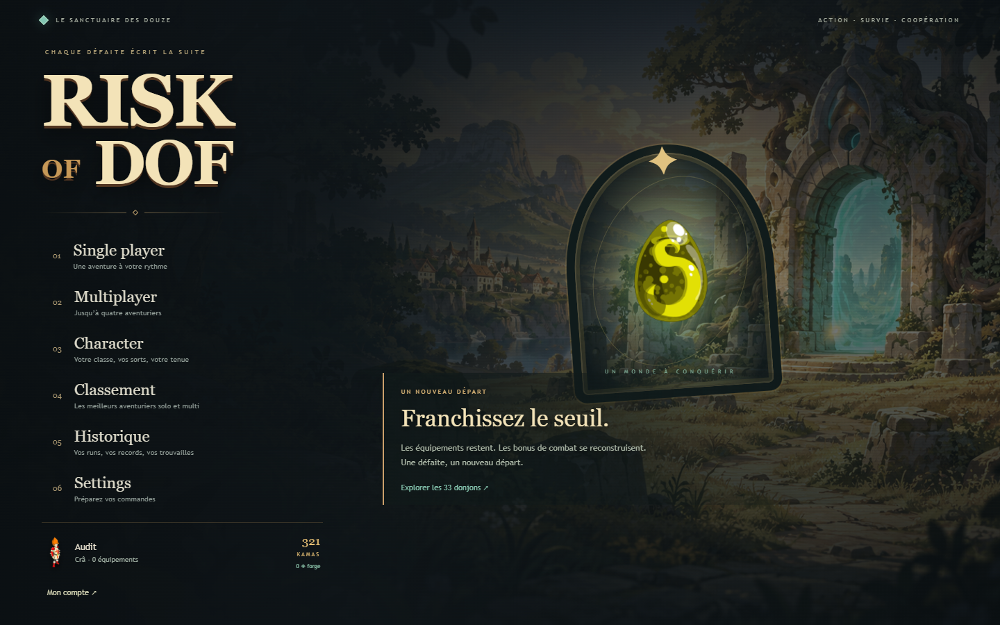

# Sanctuaire — Hades × Dofus

La nouvelle DA est implémentée sur l'accueil, la préparation solo/multi, le personnage, l'équipement, les talents, l'encyclopédie, les comptes, le classement, l'historique, le marchand et le HUD. Pierre sombre, laiton et braise structurent les commandes ; les teintes de Wakfu signalent la progression et les synergies. Les sprites, icônes d'équipements et animations Retro sont conservés.

**Settings → Direction artistique** permet de comparer Sanctuaire et Parchemin. Le choix est sauvegardé dans les réglages du compte. Les pages ont été vérifiées à 1 440 × 900 et l'accueil/personnage à 390 × 844. Le clavier reste contenu dans les fenêtres ; Échap revient à la page précédente. L'historique garde ses lignes compactes et la meilleure run épinglée dans sa liste.



[Équipement](previews/sanctuaire-equipement.png) · [Marchand](previews/sanctuaire-marchand.png) · [Atlas](previews/sanctuaire-atlas.png) · [Accueil mobile](previews/sanctuaire-mobile.png)

## Trois choix de risque, une route commune

Chaque halte marchande propose un serment pour **la prochaine zone seulement**, en plus des six achats et du reroll. L'ordre des 33 donjons reste inchangé.

| Serment | Risque | Récompense |
|---|---|---|
| Voie du voyageur | Difficulté habituelle | Une bénédiction du gardien |
| Chasse sauvage | Budget de renforts +30 %, dans la limite de créatures | Kamas sur les ennemis +30 % |
| Serment du gardien | Gardien : PV +35 %, dégâts +15 % | Deux choix successifs de bénédiction |

Chaque joueur vote avant de se déclarer prêt. La majorité décide ; l'hôte départage les égalités. Un vote figé ne peut pas changer pendant l'attente. Le serment choisi apparaît sous l'objectif du HUD. Ces choix ne changent pas la probabilité de base des Dofus.

## Construire des affinités

Les bonus de combat appartiennent à trois familles. Réunir 3 puis 5 **bonus différents** donne des avantages cumulatifs. Plusieurs copies ou qualités d'un même bonus comptent une seule fois : diversifier ses achats devient une vraie décision, sans interdire les cumuls d'Échos.

| Affinité | 3 bonus différents | 5 bonus différents, en plus |
|---|---|---|
| Braise | Dégâts +8 % | Recharge +4 %, dégâts critiques +10 % |
| Sève | PV max +25 | Armure +0,8, régénération +0,3 PV/s |
| Wakfu | Recharge +6 % | Vitesse +2,5 %, portée +0,5 |

Les familles et leur avancement sont affichés sur les offres du marchand et dans Tab. Le HUD indique les seuils atteints. Les avantages sont calculés côté serveur, inclus dans le récapitulatif de stats et l'historique, puis supprimés au prochain départ. La tenue permanente reste un système séparé.

Exemples de directions de build : Crâ/Braise pour renforcer les flèches chargées ; Iop/Sève pour soutenir les boucliers au contact ; Féca/Wakfu pour multiplier les placements et réactivations de glyphes. La disponibilité aléatoire des offres laisse place à l'adaptation plutôt qu'à une recette garantie.

## Atlas et taux de drop

L'atlas de l'accueil présente les 33 donjons, leurs gardiens, habitants, paliers d'équipement et poids des pools. Chaque ligne se développe au clic ; aucun atlas de monstre lourd n'est chargé pour consulter cette page.

L'encyclopédie simule désormais le **taux individuel réel** de l'objet sélectionné selon la zone et le passif Enutrof. Elle utilise la même fonction que le serveur : pool de zone, deux zones précédentes, raretés précédentes ×3 et multiplication individuelle ×2. Un objet hors du pool affiche 0 %. Les Dofus restent accessibles dans toutes les zones, sur les boss uniquement.

## Lisibilité et fluidité

- Les petits effets décoratifs sont limités et les textes de dégâts réutilisés. Les dégâts/boucliers du joueur local disposent d'un budget réservé. Aucun plafond n'est ajouté aux attaques ou aux cumuls d'Échos.
- Un coup ordinaire n'interrompt plus la prédiction de déplacement pendant 200 ms. Les reculs/dashes/téléports gardent la position autoritaire et les changements d'epoch.
- Le rendu Standard regroupe huit textures par lot. Un rafraîchissement du cache des liaisons avant le dessin évite les références périmées après uploads de canvas et changements de carte. Le mode Compatibilité garde une texture par lot.
- Les tailles des monstres sont calculées une seule fois à partir de leur silhouette au repos : boss bornés à 210 × 180 pixels, autres sprites à 110 × 100 avant zoom. Cela évite notamment un Kralamoure qui couvre tout l'écran. Les monstres au premier plan deviennent plus transparents lorsqu'ils masquent le héros local.
- Le HUD présente des blocs plus compacts. La forge permanente est dans le profil, l'inventaire et Tab, séparée de la mécanique de classe.
- **Settings → Performances en jeu** affiche les images réellement rendues par seconde, l'aller-retour réseau et le nombre de créatures. Le compteur ne confond pas callbacks RAF et images du jeu.

Comparaison locale avec la même graine, un Iop et 160 monstres, après création de 80 textures de texte pour solliciter les changements WebGL :

| Mode | Appels de dessin médians / image | p95 | Erreurs WebGL |
|---|---:|---:|---:|
| Compatibilité | 344 | 381 | 0 |
| Standard | 9 | 15 | 0 |

Le nombre d'appels baisse d'environ 97 %. **Le navigateur headless reste autour de 40–41 FPS dans les deux modes** ; cette comparaison ne permet pas d'annoncer un gain de FPS chez les joueurs. Le gain de regroupement doit être évalué sur leurs GPU, et le ping sur leur connexion. Les 33 cartes ont été revisitées en rendu Standard sans exception JavaScript, après les créations de textures.

## Validation et équilibre

69 tests fonctionnels, dont un vrai réseau à deux joueurs pour le vote, les charges, les scores de run, les Zaaps et la reconnexion. Vérification TypeScript des trois paquets **et des outils de simulation**. Build de production. Le pipeline GitHub exécute aussi les tests avant publication.

Le parcours navigateur compte/profil → import des anciens objets → choix de classe → run → rechargement → marchand/serment → score Supabase → classement/historique → second navigateur passe. Les comptes temporaires ont été supprimés après les essais. Les vues des 33 donjons et le changement de thème ont été vérifiés, avec captures des principales pages.

Nouvelle série de 192 simulations : 12 classes, deux graines, quatre tenues, normal et difficile. Bot sur les actions publiques, collisions et télégraphes réels, voie habituelle. Plafond zone 12 et 1 200 secondes : les moyennes des runs encore vivantes sont des bornes inférieures.

| Stuff | Normal : zone moyenne | Vivantes / 24 | Difficile : zone moyenne | Vivantes / 24 |
|---|---:|---:|---:|---:|
| Aucun | 1,96 | 0 | 1,67 | 0 |
| Palier 20 rare | 2,17 | 0 | 1,92 | 0 |
| Palier 80 rare | ≥ 5,04 | 1 | ≥ 4,33 | 1 |
| Palier 160 rare | ≥ 11,38 | 18 | ≥ 10,21 | 12 |

Les runs sans stuff en normal meurent entre les zones 1 et 3 : l'objectif de départ reste respecté. Les affinités donnent une progression modeste et ne remplacent pas l'équipement.

Une exploration complémentaire de 24 runs (Crâ, Iop, Féca, Osa, deux graines, stuff 80 rare) compare les serments : voie habituelle ≥ 5,63 zones, chasse ≥ 5,50, gardien ≥ 5,75. Deux runs sur huit restent vivantes dans chaque groupe au plafond de la zone 8. Ces échantillons sont trop petits pour affirmer qu'un serment domine les autres ; ils vérifient que les risques et récompenses permettent des trajectoires distinctes. Les modifications sont choisies via les vraies actions du marchand, avec une assertion du serment effectivement appliqué.

Commandes :

```powershell
npm.cmd run typecheck
npm.cmd test
npm.cmd run build
npm.cmd run simulate:runs -- --seeds=2 --tiers=-1,0,2,4 --modes=1,2 --cap=12 --seconds=1200
npm.cmd run simulate:runs -- --seeds=2 --classes=cra,iop,feca,osamodas --tiers=2 --routes=normal,hunt,ordeal --cap=8 --seconds=900
```

## Déploiement et classement

Le protocole de jeu passe à 3 pour éviter de présenter les serments à un serveur qui ne les connaît pas. Le client GitHub Pages et le serveur Railway doivent utiliser le même commit. Les redéploiements du serveur terminent les parties qu'il gardait en mémoire.

Le classement fonctionne avec le serveur local et Supabase. Le serveur public Railway a répondu **`ranking: false`** lors du contrôle : il ne charge pas de clé d'écriture. Il faut ajouter `SUPABASE_SECRET_KEY` dans **Railway → service du jeu → Variables**, avec la clé déjà présente dans `server/.env`, puis redéployer. Le fichier local et les variables Render ne configurent pas Railway. Aucun secret n'est inclus dans les commits.
