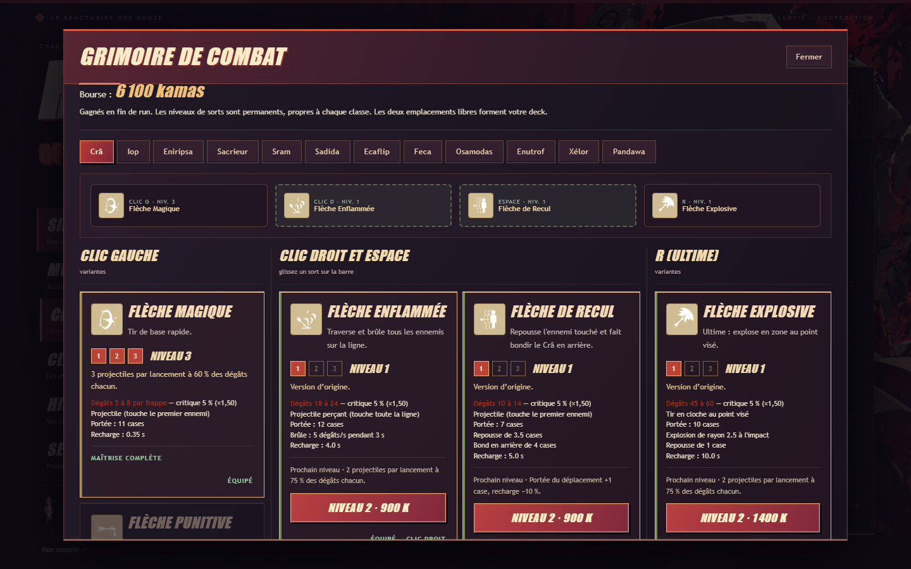
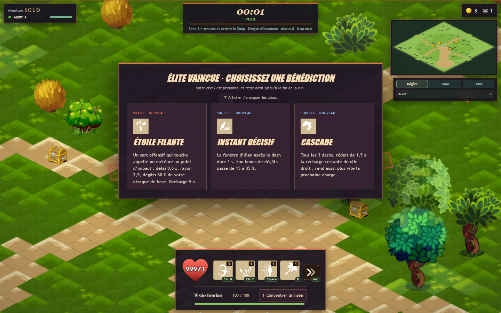
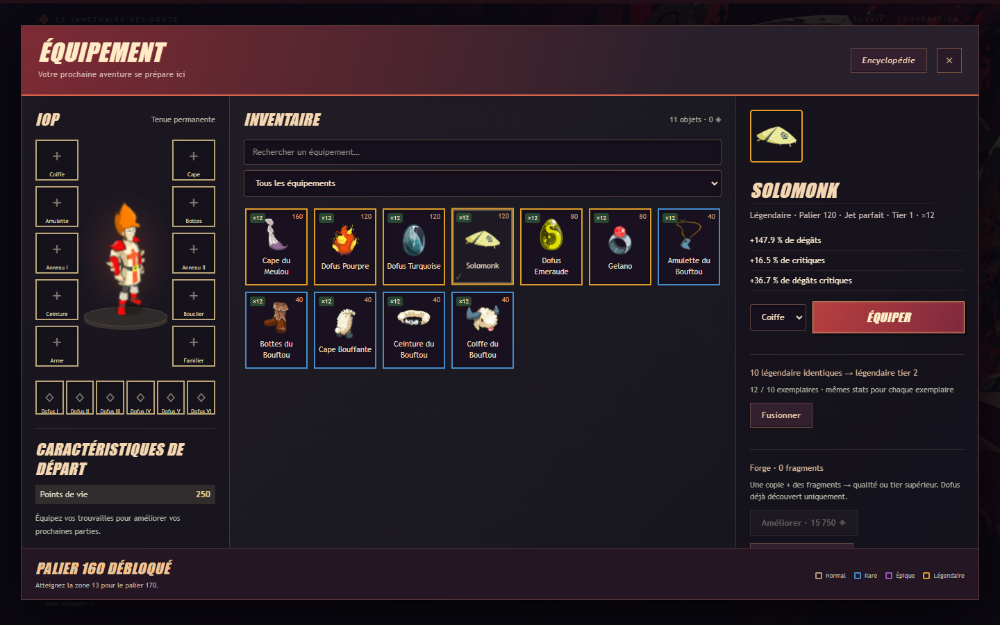

# Sorts, bénédictions et level design

Version historique du 15 octobre 2026. Les anciennes évolutions permanentes et les récompenses en kamas sont remplacées par [la progression XP et les cinq paliers](REFONTE_XP.md).

## Changements jouables

Les kamas de fin de run achètent les niveaux de sorts dans Character → Talents. Les kamas de combat restent consacrés aux coffres et au marchand. Les achats sont propres à chaque sort et chaque classe, conservés dans la sauvegarde existante et relus depuis le profil authentifié par le serveur. Ils sont figés pendant une run.

| Emplacement | Niveau 2 | Niveau 3 |
|---|---:|---:|
| Attaque de base | 600 K | 2 400 K |
| Compétence libre | 900 K | 3 600 K |
| Ultime | 1 400 K | 5 600 K |

Les attaques offensives produisent deux coups à 75 % puis trois à 60 %, soit 150 % puis 180 % du total de base. Les échos gagnés en combat conservent leur puissance : monter un sort ne diminue jamais leur efficacité. Les copies ne comptent pas comme des lancements supplémentaires pour les passifs de classe. Les soins suivent le même partage ; invocations, boucliers, résurrection, buffs et mobilité ont des évolutions spécifiques affichées avant achat. Les animations Retro sont conservées et répétées ; aucune nouvelle animation originale prétendue.

L’élan récompense une attaque de base dans les 0,65 s après un dash : +15 % dégâts, projectile perforant ou cône +30°, bref arrêt de 0,18 s des ennemis hors boss. Une seule consommation par esquive. La bénédiction Instant décisif peut renforcer cette fenêtre.

## Élites : choix personnel

Une élite ennemie morte remplace son ancien bonus aléatoire par trois bénédictions distinctes pour chaque joueur, même un soutien qui ne l’a pas frappée. Un joueur KO garde sa récompense jusqu’à son retour. Chacun choisit pour lui-même ; le combat multi continue. Le panneau peut être replié et les choix attendent aussi au marchand. Plusieurs récompenses se mettent en file, sans écrasement. Les bénédictions liées aux invocations ou aux glyphes ne sont proposées que si le deck les utilise.

Une bénédiction possédée peut être renforcée au rang 2 puis 3. Les descriptions de renforcement sont explicites : la plupart augmentent la puissance de 20 % puis 40 % par rapport au premier rang, sans changer les durées/recharges. Ricochet, Zéphyr, Instant décisif et Domaine sacré ont leurs propres valeurs affichées. Les anciens choix en attente sont corrigés si un pouvoir atteint déjà le rang maximum. Les pouvoirs disparaissent à la prochaine run ; leur récap reste dans son historique.

| Famille | Bénédiction | Effet au rang 1 |
|---|---|---|
| BRAISE | Foulée ardente | Chaque dash laisse une explosion au départ : délai 0,45 s, rayon 2,4, dégâts 45 % de votre attaque de base. |
| BRAISE | Marque de braise | Une attaque de base embrase sa cible pendant 3 s : 12 % de votre attaque de base par seconde. Recharge 0,8 s. |
| BRAISE | Bûcher funèbre | Vos victimes explosent dans un rayon de 2,2 : 35 % de votre attaque de base. Recharge 0,8 s ; aucune réaction en boucle. |
| BRAISE | Étoile filante | Un sort offensif qui touche appelle un météore au point d’impact : délai 0,6 s, rayon 2,5, dégâts 60 % de votre attaque de base. Recharge 5 s. |
| BRAISE | Combustion | Vos sorts infligent 20 % de dégâts supplémentaires aux ennemis en feu. Combinez avec Marque de braise ou un sort de brûlure. |
| WAKFU | Orage en chaîne | Toutes les 4 attaques de base touchées, un éclair saute sur 3 autres ennemis à 4 cases : 35 % de votre attaque de base par cible. Les copies ne comptent pas. |
| WAKFU | Pas foudroyant | Chaque dash foudroie l’ennemi le plus proche à 4 cases : 40 % de votre attaque de base. |
| WAKFU | Résonance | Lancer une compétence prépare votre prochaine attaque de base : +35 % de dégâts. Les projectiles de son niveau profitent du même bonus. |
| WAKFU | Ricochet astral | Votre attaque de base gagne un rebond supplémentaire. Se cumule avec les rebonds obtenus dans la run. |
| WAKFU | Rupture de Wakfu | Tous les 3 sorts offensifs distincts qui touchent, frappe autour de la cible : rayon 2,6, dégâts 70 % de votre attaque de base. |
| SEVE | Écorce vengeresse | Après une perte de PV non fatale : bouclier de 6 % des PV max pendant 3 s et riposte à 2,6 cases, dégâts 45 % de votre attaque de base. Recharge 6 s. |
| SEVE | Sève vitale | Une victime vous rend 2 % de vos PV max. Recharge 2 s ; pas de soin à pleine vie. |
| SEVE | Écorce nomade | Chaque dash donne un bouclier de 4 % de vos PV max pendant 3 s. Ne se cumule pas avec lui-même. |
| SEVE | Floraison protectrice | Un soin de sort ou de potion ajoute 20 % des PV réellement rendus en bouclier pendant 3 s. Plafond du gain : 10 % de vos PV max. |
| SEVE | Racines entravantes | Une attaque de base ralentit sa cible de 30 % pendant 1,5 s. Recharge 1 s. |
| OMBRE | Sceau funeste | Une attaque de base marque sa cible : après 1,1 s elle subit 90 % de votre attaque de base. Recharge 3 s ; la marque disparaît si la cible meurt. |
| OMBRE | Sentence | Vos sorts infligent 25 % de dégâts supplémentaires aux ennemis sous 25 % de leurs PV. |
| OMBRE | Œil du chasseur | Vos sorts infligent 20 % de dégâts supplémentaires si la cible est à plus de 6 cases de vous. |
| OMBRE | Serment du contact | Vos sorts infligent 20 % de dégâts supplémentaires si la cible est à moins de 2,5 cases de vous. |
| OMBRE | Moisson critique | Un coup critique vous rend 1,5 % de vos PV max. Recharge 1 s. |
| SOUFFLE | Faveur du Zéphyr | Recharge de votre dash réduite de 15 %. |
| SOUFFLE | Instant décisif | La fenêtre d’élan après le dash dure 1 s. Son bonus de dégâts passe de 15 à 35 %. |
| SOUFFLE | Cascade | Tous les 3 dashs, réduit de 1,5 s la recharge restante du clic droit ; rend aussi plus vite la prochaine charge. |
| SOUFFLE | Contre-pied | Une onde frappe à votre arrivée 0,2 s après le dash : rayon 2, dégâts 40 % de votre attaque de base. |
| SOUFFLE | Onde de recul | Chaque dash repousse de 1,2 case les ennemis ordinaires à 2,8 cases du départ. Les élites et les boss résistent. |
| PACTE | Légion fidèle | Les nouvelles invocations gagnent 35 % de PV max. Le Coffre Animé conserve ses PV égaux aux vôtres. |
| PACTE | Marque de meute | Une invocation qui frappe marque sa cible 3 s. Vos sorts infligent 20 % de dégâts supplémentaires à cette cible. |
| PACTE | Domaine sacré | Les nouveaux glyphes et pièges gagnent 0,4 case de rayon. Pour les pièges, l’explosion grandit aussi. |
| PACTE | Contre-garde | Vos sorts infligent 20 % de dégâts supplémentaires tant que vous avez un bouclier. |
| PACTE | Convergence | Vos sorts infligent 25 % de dégâts supplémentaires aux ennemis qui cumulent au moins deux états : brûlure, ralentissement ou étourdissement. |

## Inspirations documentées

[Supergiant, High Speed Update de Hades](https://www.supergiantgames.com/blog/hades-the-high-speed-update-patch-notes/) décrit les attaques après dash, Double Nova, les transformations du marteau et l’amélioration des entrées. [Supergiant, Big Bad Update](https://www.supergiantgames.com/blog/hades-big-bad-update-patch-notes/) présente les interactions de bénédictions et effets retardés. [La présentation officielle de Vampire Survivors par poncle](https://store.steampowered.com/app/1794680/Vampire_Survivors/) met en avant la montée en puissance par les choix, les niveaux d’armes et l’or dépensé entre les runs. L’adaptation ici utilise les sorts et états du jeu Dofus existant ; les chiffres sont propres à Risk of Dof.

## Audit du level design

- Quatre formations : poursuite rapide, tirs croisés, horde regroupée et tenaille. Les deux premiers assauts d’Incarnam restent de petits groupes.
- Même budget de crédits ; les formations à deux ailes utilisent un secteur de 120° pour laisser une direction de sortie. La position finale de chaque apparition reste à au moins 10,5 cases de tout joueur vivant et hors obstacle. Une aile bloquée peut être absente.
- Une respiration de 6 s tous les cinq assauts hors charge du Zaap ; cadence de 4–5,5 s sinon. Le marchand reste vide, temps figé.
- Deux espaces de combat reliés, rayon 4,5, facilitent le changement d’angle et la pose de zones. Les chemins restent dégagés.
- Arène des gardiens : rayon 5,5 → 7,5 pour laisser de l’espace aux doubles/triples gardiens et à leurs annonces de zone. Leur alternance d’attaques reste active.
- 132 cartes contrôlées : départ libre, connexion départ/arène et plus de 99,96 % des cellules libres accessibles dans le pire cas. Ces cartes sont des variantes procédurales du terrain Retro existant.

## Simulations de runs

12 classes × 2 graines × 3 tenues × 2 niveaux de sorts : **144 nouvelles runs** avec recherche des balises d’élite et sélection personnelle de bénédictions. Le bot utilise les actions publiques, vraies collisions, dégâts et cooldowns, ouvre les coffres et achète au marchand. Il choisit la première bénédiction tirée, sans optimisation de synergie ; il recherche les balises avant le Zaap. Les tenues sont rares T1, sans Dofus. Normal, limite de neuf zones franchies ou 1 000 s. Les runs vivantes à la limite donnent une borne basse, pas une mort.

| Stuff | Sorts 1 : zone observée moyenne | Encore vivants /24 | Sorts 3 : zone observée moyenne | Encore vivants /24 |
|---|---:|---:|---:|---:|
| Aucun | 1.88 | 0 | 2.00 | 0 |
| Palier 40 rare T1 | ≥ 2.58 | 1 | ≥ 3.79 | 1 |
| Palier 80 rare T1 | ≥ 5.79 | 7 | ≥ 6.96 | 8 |

Sans équipement, niveau 1 : 1,88 zone (1–2). Niveau 3 : 2,00 (2–2). Les achats ne remplacent donc pas le stuff dans ce protocole. Les élites étant facultatives, un premier contrôle sans les rechercher avait donné 2,00 et 2,04 zones sans stuff. Une autre série de 144 runs a servi à ce contrôle. Les chiffres ne prédisent pas le niveau d’un humain, la qualité d’une synergie particulière ou le ping des amis.

Reproduire :

```powershell
npm.cmd run simulate:runs -- --seeds=2 --tiers=-1,1,2 --cap=9 --seconds=1000 --spell-level=1 --elites=seek --out=artifacts/elite-level1
npm.cmd run simulate:runs -- --seeds=2 --tiers=-1,1,2 --cap=9 --seconds=1000 --spell-level=3 --elites=seek --out=artifacts/elite-level3
node --import tsx tools/audit-level-design.ts
```


Contrôle complémentaire : départ en zone 18, sorts 3, quatre classes (Crâ, Iop, Féca, Osamodas), une graine, plafond de zone 24 ou 1 800 s. Les 16 runs distinguent une tenue dépassée d’une tenue finale :

| Mode | Stuff | Moyenne observée | Encore vivants /4 |
|---|---|---:|---:|
| Difficile | Palier 160 rare T1 | 18.50 | 0 |
| Difficile | Palier 200 rare T1 | ≥ 24.50 | 4 |
| Cauchemar | Palier 160 rare T1 | 18.00 | 0 |
| Cauchemar | Palier 200 rare T1 | ≥ 21.50 | 4 |

## Charge et vérifications

Mesure locale sans rendu, quatre joueurs, 160 ennemis maintenus, 1 800 ticks par scénario. Les invocations s’ajoutent au nombre des ennemis. La durée complète inclut les actions du bot et le maintien artificiel de la population.

| Scénario | Tick simulation p95 | Tick complet p95 | Pic de créatures |
|---|---:|---:|---:|
| Sorts 1 | 0.505 ms | 0.526 ms | 161 |
| Sorts 3 | 0.540 ms | 0.553 ms | 165 |
| Sorts 3 + tous les 30 pouvoirs (stress) | 0.488 ms | 0.504 ms | 165 |

Le test de stress utilise les 30 pouvoirs ensemble, même incompatibles avec le deck, pour tester les branches et les réactions. Cette mesure CPU exclut sérialisation réseau, rendu GPU et latence : elle ne démontre pas 60 FPS chez tous les joueurs.

100 tests fonctionnels passent, ainsi que le typecheck et le build. Le parcours navigateur a vérifié les achats réels de niveaux, leur sauvegarde Supabase, les niveaux relus par le serveur, les trois cartes d’élite, le choix, la reconnexion conservant le build, le marchand, l’historique sur un second appareil et le classement du serveur local. Tests desktop 1440×900 et fenêtres 390×844, aucune erreur JavaScript dans ce parcours.

## Points à surveiller en playtest

- Mesurer si les coûts du niveau 3 incitent à améliorer un deck avant de le diversifier ; ne pas baisser toutes les dépenses sur la seule base des bots.
- Jouer en groupe avec soutien : la récompense est partagée, mais il faut vérifier la lisibilité de plusieurs invocations et zones superposées.
- Le contrôle complémentaire distingue bien tenue 160 dépassée et tenue 200 en Cauchemar ; une partie humaine complète jusqu’au Kralamoure reste utile. Les anciennes simulations couvrant les 33 zones décrivent la version antérieure.
- Le menu de choix reste utilisable plus tard. En multi, replier les cartes permet de continuer à esquiver sans imposer de pause au groupe.

## Assets remastered

Inspection de l’installation locale `AppData/Local/Ankama/Retro/resources/app/retroclient/clips/spells/icons` et de `Downloads/dofus-1.41.7-remastered.zip` : 677 fichiers d’icônes comparés, 675 identiques. Les deux différences sont `up/-1.swf` et `up/556.swf`. L’export direct de `up/161.swf` (Flèche Magique) est un pictogramme blanc transparent, pas une illustration colorée. Aucun pack d’icônes de sorts illustrées en couleur n’a été identifié dans ces deux sources. Les icônes existantes sont conservées.

## Aperçus






